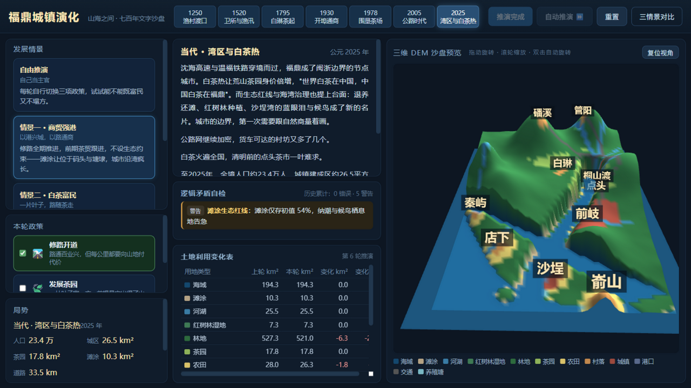

# 福鼎城镇演化 · 文字沙盘

一座以**福鼎真实地理**（真实市域轮廓 + SRTM 真实高程）为约束的城镇演化推演沙盘：从南宋渔村渡口，
到当代湾区与白茶热，六个时代七百年的选择，全部落在一块 72×72 格（格距 0.8km）的纸墨海图上。



## 启动

```
启动.bat          → http://127.0.0.1:8943
（或 node server.js 8943）
```

零依赖：Three.js 已本地化在 `vendor/`，Node 只当静态服务器，file:// 直开 `index.html` 亦可。

## 怎么玩

1. **选情景**（左栏）：三个预设发展路径 + 自由推演；
2. **推进一轮**（顶栏）：每轮跨越一个时代，自动输出——
   - **叙事文本**：时代背景 × 政策影响 × 事件 × 数字小结；
   - **土地利用变化表**：12 类用地的上轮/本轮/变化（格数守恒自校验）；
   - **Three.js 三维 DEM 预览**：用地配色地形 + 海面 + 城镇标签，拖动旋转/滚轮缩放/双击自动旋转；
3. **看逻辑矛盾自检**：每轮自动校验（详见下），错误/警告直接列在面板里；
4. **三情景对比**：终局一键对比三套政策路径的人口/用地/评分。

## 三种发展情景

| 情景 | 路线 | 典型结局（2025） |
|---|---|---|
| 情景一 · 商贸强港 | 修路全开，茶贸跟进，不设生态约束 | 城区最大（81km²），滩涂只剩 13% 触发生态红线，**龙安开发区**围海落地 |
| 情景二 · 白茶富民 | 茶园全期深耕，路随茶走，后期护岸 | 茶园最大（92km²），综合分最高 |
| 情景三 · 生态湾区 | 生态全期优先，路网适度 | 滩涂完整（45km²，生态分 68），城区克制，龙安缓建 |

政策机制：
- **🛣️ 修路开道**：以桐山为枢纽数值寻路（坡度+水体代价），路通则茶出山、城沿路长；无路时山区茶利折半；
- **🍃 发展茶园**：只在 60~780m、坡度 ≤26° 的丘陵林地立地；
- **🦪 海岸生态保护**：围垦造塘被叫停、退养还滩、红树林补种，滩涂+湿地合并守护；
- **🏗️ 龙安开发区**（政策门控事件）：历史原型为沙埕湾口围垦而生的省级开发区。第 5 轮（改革开放）起，**只要该轮未开生态保护**，就在湾口南岸滩涂上填海造区（6 格厂房+路网），第 6 轮继续扩张；开生态则缓建——叙事会明确交代这笔账。

## 自动逻辑矛盾校验（10 类规则）

每轮推演后自动运行（`js/validate.js`），面板实时显示：

| 规则 | 检什么 |
|---|---|
| 用地守恒 | 每格有且仅有一种用地，格数合计 = 格网总数 |
| 水体完整 | 建设用地不得侵占海湾/河流（河桥、岸上港口例外） |
| 茶园立地 | 茶园必须在 60~780m、坡度 ≤26° |
| 城镇可达 | 建成区必须临路或临水（渡口），孤村给警告 |
| 生态保护冲突 | 生态期滩涂+湿地不得净减少、不得新增养殖塘 |
| 滩涂生态红线 | 滩涂低于初值 85% 给警告 |
| 人口承载力 | 人口超土地承载力 15% 判矛盾，15% 内给警告 |
| 叙事一致 | 叙事里的数字必须与推演数据吻合（防口说无凭） |
| 道路合理 | 道路不得落海湾深水、路网片须连接聚落 |
| 港口选址 | 码头必须在邻水深 ≤-4m 的岸线 |
| 海域守恒 | 开敞海域任何时代不可被侵占 |

引擎与校验器联动：人口超载的下一轮自动触发"人口外流"，沙盘会自我纠偏并写进叙事。

## 地理骨架（真实轮廓 + SRTM 真实高程）

- **市域轮廓**：`tools/extract-boundary.js` 把用户提供的福鼎市域轮廓图解码、栅格化为 72×72 掩膜
  （`js/boundary.js`，主陆 2623 格 + 嵛山岛 39 格），轮廓之外即为东海。
- **真实高程**：`tools/fetch-dem.js` 从 opentopodata.org 抓取 **SRTM 30m** 高程
  （144×144 细采样聚合为 72×72，bbox 全幅地理配准：119.917–120.717°E / 26.867–27.433°N，
  产物 `js/realdem.js`）。管阳/泰顺界山 ~820m、磻溪群山、太姥山（南，覆鼎峰 917m 一带）、
  店下/前岐滨海平原、沙埕湾水域全部落在真实位置；断网或文件缺失时自动退回确定性程序化地形
  （`js/terrain.js`，seed 20261029）。
- **手绘形状优先**：轮廓是地图，高程是地貌——轮廓盖在真实海岸线之外的格按滨海低地合成，
  嵛山岛按真实主峰红纪洞山 541.4m 造山。
- 沙埕港楔形深水湾（湾口 -26m → 湾顶 -6.5m）、七河水系、十一处镇址
  （含第 5 轮才可能登场的龙安开发区）全部落位陆地。
- 面积/人口/用地为**全境口径**：2025 年情景一人口 58.8 万，与真实福鼎（约 56 万常住）同量级。

## 测试

```
node test\test.js
```

86 项断言：地形体检（含真实轮廓陆域规模/嵛山岛/湾道纵深） / 用地守恒与海域恒定 /
三情景两轮推演指纹一致（确定性）/ 三情景分化断言（含龙安开发区门控：A 情景第 5 轮落地、
生态情景缓建、第 4 轮前不存在）/ 校验器 10 类矛盾检出（逐一植入反例）/
40 组随机政策模糊推演（零异常、零结构性矛盾）/ JSON 序列化往返。全绿退出码 0。

质检历程（bug 发现与修复全记录）见 `report/质检报告.md`。

## 文件结构

```
index.html            页面入口（纸墨海图风）
style.css             宣纸底/墨字/朱砂印样式，去渐变去 emoji
server.js             零依赖静态服务器（默认 8943，no-store）
vendor/three.min.js   Three.js r148（本地化）
js/boundary.js        真实市域轮廓掩膜（由 tools/extract-boundary.js 生成）
js/realdem.js         SRTM 真实高程栅格（由 tools/fetch-dem.js 抓取，可离线缓存重跑）
js/terrain.js         地形合成（真实 DEM 优先，程序化兜底；掩膜/湾道/河道/镇址）
js/data.js            用地类型/时代/政策/情景/事件/承载力
js/engine.js          推演状态机（建路寻路/用地转换/人口/叙事生成）
js/validate.js        10 类逻辑矛盾校验器
js/three-view.js      Three.js 三维 DEM 预览（自制轨道控制，纸色海图渲染）
js/ui.js              浏览器壳（时间轴/情景/面板/对比）
tools/extract-boundary.js  轮廓图 → 掩膜提取器（PNG 解码/洪泛/降采样，可重跑）
tools/fetch-dem.js         SRTM 高程抓取器（opentopodata，断点缓存，可重跑）
test/test.js          自动化质检（87 项断言）
report/质检报告.md     质检历程与修复记录
```
